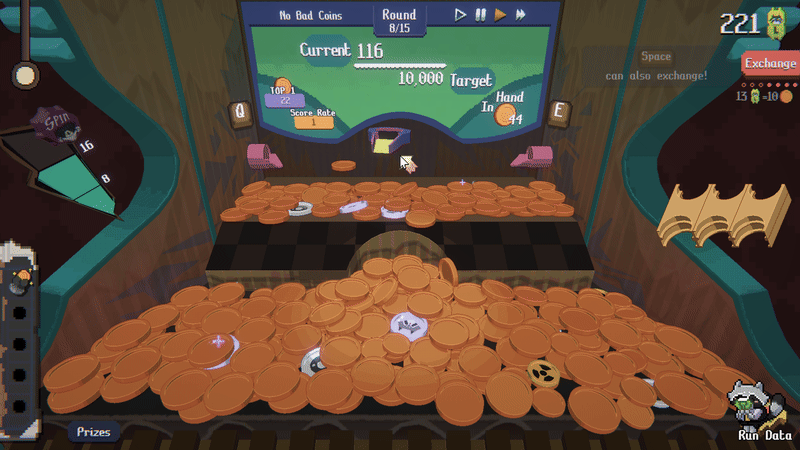

<div align="center">


### Run PC games on Xbox Series X|S — natively.

**A Windows PE64 application runtime for Xbox Dev Mode.**
Wine's job, targeting UWP instead of POSIX.


[How it works](#-how-it-works) · [Proof](#-proof--console-run-2026-11-19) · [What this proves](#-what-this-proves) · [Status](#-status-honest) · [Build](#-build-linux-all-cross) · [Deploy](#-deploy-console) · [Evidence](docs/03-evidence.md) · [Gap map](GAP-MAP.md)

**[⬇ Download the release](https://github.com/xanstomper/tiramisu/releases)** · **[🎮 Compatibility](#-what-boots-today)**

</div>

---

## What is this?

One signed UWP app that loads Windows `.exe`s **in-process** on Xbox
Series X|S Dev Mode. No CPU emulation for 64-bit games: the console is x64,
so guests run at **native speed** on the same core, the same ABI, the same
process — Tiramisu is the operating system around them.

```text
Tiramisu UWP host (CoreWindow + D3D11 flip + XInput, 5 GB as a Game package)
  └── trt — Tiramisu runtime
        ├── PE64 loader      map → sections → relocate → bind imports → TLS → delay imports
        ├── Win64 EH         .pdata personality, RtlUnwindEx, funclets, VEH
        ├── module table     every import routed: SYSTEM | BUILTIN | STUB
        ├── bridges          25+ Win32 families implemented on UWP
        │   ├── graphics     D3D11/DXGI (real device passthrough), D3D9/8/DDraw→D3D11,
        │   │                D3DX9/10/11, OpenGL→D3D11 (gl4es-derived), Vulkan 1.0–1.3 ICD
        │   │                (SPIR-V→HLSL→D3D11), GDI32, GDI+ (launcher UI)
        │   ├── audio        XAudio2 / DirectSound / WASAPI / OpenAL / winmm / FMOD
        │   │                → one real XAudio2 2.8 mixer (48 kHz stereo master voice)
        │   ├── system       kernel32 core+mem+thread, ntdll, advapi32 registry, ole32/oleaut,
        │   │                shell32/shlwapi, comctl32, crypt32, bcrypt, wininet, psapi,
        │   │                iphlpapi, imm32, dbghelp, setupapi/HID, winrt (Gamepad…)
        │   └── steam        QR auth (your own account) — no DRM bypass, ever
        ├── VFS              C:\ → LocalState\drive_c, D:\ → mounted .iso, Z:\ → package
        ├── budget governor  one 5 GB ledger for VirtualAlloc commit + heap + mapped views
        └── async I/O        overlapped reads → GQCS packets, mmap fast path (TRT_IO_MMAP_MIN)
```

## 🏆 Proof — console run (2026-11-19)

This is the milestone the project was built for: **two commercial 64-bit
Windows games, running in-process on Xbox Dev Mode, through the signed
Tiramisu UWP host.** No CPU emulation, no streaming, no Linux PC in the loop.

| Game | Engine / class | Console result |
|---|---|---|
| **RACCOIN** | Unity 6 IL2CPP, Steam, D3D11 | **Fully playable** — main menu, a live run, coin physics, HUD, score/round progression |
| **God of War** (PC) | AAA in-house engine, x64, D3D11 | **Boots, runs, renders** — the opening forest scene, four independent boots, each one closer than the last |

### 🦝 RACCOIN — main menu → playable run

<table>
<tr>
<td width="50%"><br/>
<sub><b>Main menu.</b> Unity UI composited through the guest's D3D11 swapchain:
Play Game, Collection, Profile, Quit, version 1.0.15. This is a real frame,
not a launcher mock-up.</sub></td>
<td width="50%"><br/>
<sub><b>Gameplay.</b> Round 8/15, Current 392, target 10,000, combo 35, a full
coin bed. The simulation, HUD and renderer are all live at once.</sub></td>
</tr>
</table>

[](docs/proof/raccoin-gameplay.mp4)

<sub>7.2 seconds of continuous play (36 frames; 1280×720 MP4, inline GIF
800×450). The board runs from Current 116 to 392 and the top-right counter
from 221 to 250 (combo 35, Round 8/15) — the same run as the gameplay still.
The coin bed moves, the multipliers update, and the sequence never drops to a
static frame. **[▶ Open the MP4](docs/proof/raccoin-gameplay.mp4)**</sub>

### 🪓 God of War — the forest renders

Four separate boot attempts, in order. Each one cleared a different class of
failure; the scene converges instead of producing one lucky frame.

<table>
<tr>
<td width="50%"><br/>
<sub><b>Boot 1 — the scene appears.</b> Kratos and the forest are recognizable,
but large black occluders, missing foliage and broken texture/material regions
still dominate the frame.</sub></td>
<td width="50%"><br/>
<sub><b>Boot 2 — materials resolve.</b> Skin, cloth, the axe, the yellow
handprint and the tree bark come through; the scene is stable enough to read
as the opening forest.</sub></td>
</tr>
<tr>
<td width="50%"><br/>
<sub><b>Boot 3 — depth returns.</b> Foliage density, tree layering, sky and
lighting composite; the frame gains the depth and silhouette of the real
scene.</sub></td>
<td width="50%"><br/>
<sub><b>Boot 4 — full composite.</b> God rays, layered trees, alpha-tested
foliage, character skinning, the axe and the handprint all render together.
This is the forest scene end-to-end.</sub></td>
</tr>
</table>

<sub>God of War captures are preview-resolution stills (256×144); they prove the
scene composition and the render path, not final output resolution or frame
pacing. The interactive front-end/menu layer and sustained gameplay are the next
gate.</sub>

## 🔬 What this proves

| Evidence | What it proves |
|---|---|
| RACCOIN main menu | The PE64 loader, Unity IL2CPP startup, D3D11 device/swapchain and guest UI all work together on console. |
| RACCOIN gameplay + clip | The managed game loop, input, simulation, HUD and renderer run **together, live** — not a synthetic render loop. |
| God of War forest | A second, much heavier AAA D3D11 renderer boots and draws a real scene: large assets, shaders, lighting, post-processing, character rendering. |
| Four God of War boots | The renderer is **converging across independent boots**; fixes remove named failure classes one at a time. |
| Same runtime for both | The loader/bridge model is engine-agnostic: Unity IL2CPP and a AAA in-house engine through one host. |

**The important part is what is no longer in question.** Before this run, the
project had proven the loader, the bridges, the render loop and the exception
handling in isolation. Now a real game reaches its own menu, starts a run and
keeps playing; a second real game reaches an in-engine scene that looks like
the game. The remaining work is compatibility breadth and polish — front ends,
sustained play, audio, performance, saves — not "can this run a PC game on the
console at all?"

It also validates the project's **fail-visible** method. The earlier God of War
boot failed with a named `0xc0000005`; the next boots did not hide the
corruption, they removed it class by class (geometry, materials, foliage,
lighting). That is slower than claiming success, and it is why the screenshots
can be trusted.

### What this does **not** prove

- **Not universal compatibility.** Two titles prove two engine classes, not
  every game. The compatibility DB is still the source of truth.
- **God of War is not "playable" yet.** The forest renders; the interactive
  front-end/menu layer and sustained gameplay are still being brought up.
- **RACCOIN's clip is 7.2 seconds.** It proves live play, not hours of
  stability or a frame-time target. Soak testing is next.
- **No DRM bypass, ever.** These are games the user owns. Anti-cheat titles,
  32-bit x86 games and D3D12-only AAA remain out of scope or unproven.

## ⚙️ How it works

### 1. Load — the PE64 loader

A real Windows PE64 is mapped from the game directory (or a mounted `.iso`):
DOS → NT headers → section mapping with per-section protections → DIR64 /
HIGHLOW relocations → import binding → TLS callbacks → **delay imports bound
eagerly** (resolvable symbols get real addresses; unresolvable ones get a
fail-visible thunk so the game boots and the log names the gap) → the whole
image is **W^X sealed** (code pages RX, no RWX ever — a two-phase JIT
fallback arms RW and flips RX on `FlushInstructionCache` for engines that
JIT, like Unity mono).

### 2. Bind — the module table

Every import routes to one of three classes:

- `SYSTEM` — the console's real DLL (proven-present families only; the host
  binds via `LoadLibraryW`+`GetProcAddress`),
- `BUILTIN` — Tiramisu implements it with Wine-observable semantics
  (kernel32 core/memory/thread, user32 window layer, graphics, audio, COM,
  registry, ~25 families, ~2,000 functions),
- `STUB` — exported, logs when called, returns 0: **fail-visible, never a
  silent lie**. Every stub hit in a log is roadmap work.

Guest-shipped DLLs (UnityPlayer, GameAssembly, SDL3, libstdc++, FMOD…)
load recursively as real PEs and their `DllMain(PROCESS_ATTACH)` actually
executes.

### 3. Run — native execution

The guest's entry point is called on a host thread at native speed. Threads
with Win32 semantics, sync primitives, TLS, real file enumeration, async
file I/O with completion ports, and the memory budget governor (one ledger
for commit + heap + mapped views; over-budget refusals are **named**, which
is what keeps the console's 5 GB Game-package limit survivable) are provided
by `trt`.

### 4. Draw — the console passthrough

The guest's `D3D11CreateDevice` gets the **host's real console device**;
`CreateSwapChainForHwnd` (and every other swapchain-creation variant) gets a
proxy over the **host's real CoreWindow swapchain** — `Present`,
`GetBuffer`, `ResizeBuffers` forward to real console DXGI. D3D9/D3D8/DDraw
games are translated onto the same backend. Vulkan games run through the
built-in Vulkan 1.0–1.3 ICD: SPIR-V → HLSL → D3D11 on the console GPU.
OpenGL games ride the gl4es-derived GL→D3D11 path. Shader execution is
**the console's real D3D11** — no shader translation needed for D3D11 guests.

### 5. Survive — Win64 exception handling

Full Win64 C++ EH — the part that took the longest: `.pdata` personality
search, two-pass `RtlUnwindEx`, MSVC funclet rethrow splicing, VEH
first-chance, and the host→guest boundary pad for exceptions that escape the
guest. Measured on real Unity IL2CPP games whose engines raise managed
exceptions through native frames.

### 6. Prove — boot ladders are measured, not promised

Every claim in the status table traces to a test or a captured log — see
[docs/03-evidence.md](docs/03-evidence.md). The offline harness can inject
mock GPU hooks so a real game's **render loop executes end-to-end** with
every vtbl call counted:

```text
RACCOIN.exe (real Unity IL2CPP Steam game) — offline boot ladder:
  CRT-STARTUP → WINMAIN → UNITYMAIN2 (IAT-probed) → WINDOW →
  D3D11 DEVICE ACQUIRED → PUMP ENTERED → PUMP QUIT
  mock-render gate: 2,730,468 device-context calls, ~268,000 DrawIndexed
  in the 10 s window, clean ExitProcess(0).                     7/7 markers
```

## 🎮 What boots today

| Game (corpus, gitignored) | Type | Result |
|---|---|---|
| **RACCOIN** | Unity 6 IL2CPP, Steam, D3D11 | **CONSOLE-PROVEN — fully playable.** Main menu → live run → coin physics → HUD/score/round progression; 7.2 s capture. [Proof](#-proof--console-run-2026-11-19) |
| **God of War** (PC) | AAA in-house engine, x64, D3D11 | **CONSOLE-PROVEN — boots, runs, renders.** Four independent boots converge on the opening forest scene; interactive front-end/menu layer next. [Proof](#-proof--console-run-2026-11-19) |
| **Ultra Pool** | Godot 4.3 + GodotSteam (Vulkan) | **Full lifecycle** — scene load → pump → Godot's own quit chain, exit(0) |
| **Go Next (demo)** | Unity IL2CPP | boots, reaches `UNITYMAIN2` |
| OrTMM | PyInstaller / commercial | full CRT→WinMain→window→pump lifecycle |
| BotW-Native (launcher + recomp exe) | BOTW Wii U static recomp | whole MinGW/SDL3/OpenSSL/glslang binary set loads + `DllMain` clean |
| GoWLauncher | Win32 launcher | loads 1/0 — launcher only, not the game above |

The console rows are the ones that matter: RACCOIN's 7/7 offline ladder,
2.7M-call mock-render gate and the playable capture are three independent
proofs of the same path; God of War adds a second, much heavier engine class.

**Engine classes covered:** Unity IL2CPP + **mono** (the W^X two-phase JIT
fallback enables runtime JIT), **AAA in-house D3D11 (God of War)**, Godot 4.x
(Vulkan), PyInstaller/Python, static-recomp ports, Win32 launchers, GDI+ UI
apps, FMOD-audio games.

**Not yet:** 32-bit x86 (PE32) games — needs the M7 x86 engine; D3D12 AAA
titles offline (console D3D12 path exists, hardware-verification pending);
Wwise/Miles-audio games (named next bridges). See
[GAP-MAP.md](GAP-MAP.md).

## 🖥️ Dashboard (TV) & phone/web dashboard

The launcher on the TV has three screens — cycle with **RB/LB** (or `Tab`):

- **Shelf** — game list (U/D pick, L/R choose the exe when a game has several),
  A launches, Y opens the Steam QR link, R3/F1 toggles gamepad-as-mouse.
  The LAN URL + QR for game transfer is always on screen.
- **Settings** — editable rows: default input mode (`auto`/`controller`/`kbm`/
  `pad2kbm`), pad-as-mouse + wheel speed, pad vibration on/off, the **Windows
  version reported to games** (major.minor.build, Win11 personality toggle),
  write-watch GC on/off (GetWriteWatch kill-switch), Steam link on/off,
  QR overlay on/off, log tail size. Every change persists to
  `LocalState\settings.ini` and applies to guests immediately.
- **Live log** — the same ring the web dashboard shows, streamed from memory.

The phone/PC web dashboard (open the LAN URL shown on the TV, or scan the QR)
adds a Connect card, the game manager (**upload folder/zip → extract → pick
exe**, per-game args/appid/input, launch/stop/delete), the live log, and the
**same settings editor** (`GET/POST /api/settings`) — all offline-gated in
`tests/test_webxfer.cpp`.

## 🚀 Quick start (console)

```sh
# 1. install the runtime (from a PC on the same LAN)
DP_HOST=<console-ip> DP_PASS=<portal-pass> \
  tools/deploy.sh install out/Tiramisu.msix out/dev.cer

# 2. open the dashboard shown on the TV (or scan the QR) and upload
#    your game as a folder or .zip — pick its .exe — press launch

# 3. watch the TV
tools/deploy.sh screenshot tv.png
```

Prereqs on the console: Device Portal enabled and **"Treat UWP apps as games
by default" ON** (5 GB limit, not 1 GB). Games you **own**; DRM-free builds
or your own Steam account auth. **No DRM bypass, ever.**

## 🔨 Build (Linux, all cross)

```sh
tools/build-test.sh    # full offline gate: 49 suites, real PE guests executed
tools/build-host.sh    # the UWP host cross-build (clang-cl + lld-link)
tools/pack.sh          # makemsix pack + sign + verify → out/Tiramisu.msix
```

Needs: LLVM 19 (`clang-cl`, `lld-link`), xwin splat at
`~/.cache/uwp-crossbuild/xwin`, `makemsix`, `osslsigncode`, and the
uwp-crossbuild wrapper (defaults to `~/gow-uwp/ref/uwp-crossbuild`; override
with `UWP_CROSSBUILD`). Python + Pillow for the branding assets
(`package/branding/` is the source of every packaged logo; regenerate with
`python3 tools/gen-assets.py`).

## 📊 Status (honest)

> Every layer is "done" only when a test or a console run proves it.
> Failures are **visible and named** — never silent.

| Layer | State |
|---|---|
| Offline loader (real PE guest executed on Linux) | **PASS** — mapping, DIR64/HIGHLOW reloc, import binding, delay imports, W^X seal, entry execution |
| Win64 C++ EH (SEH) | **PASS** — pass-1 personality search, RtlUnwindEx pass-2, funclet rethrow splice, geometric purge, VEH, boundary swallow pad |
| Real-game corpus | **PASS** — 29 PEs load; **RACCOIN playable on console**; **God of War renders the forest on console**; UltraPool/GoNext/OrTMM boot; render loop proven (2.7M GPU calls) |
| D3D11/DXGI guest | **PASS on console** — real device + CoreWindow swapchain handed to RACCOIN and God of War; full swapchain proxy |
| D3D9/D3D8/DDraw → D3D11 bridges | **BUILT** — SDK-exact vtables |
| Vulkan 1.0–1.3 ICD (SPIR-V→HLSL→D3D11) | **BUILT** — Godot 4.3 boots through it |
| Audio (XAudio2 / DirectSound / WASAPI / OpenAL / winmm / **FMOD**) | **BUILT** — one real XAudio2 2.8 sink; FMOD WAV/OGG decode for real |
| Memory + budget governor | **BUILT** — 5 GB ledger, W^X two-phase JIT (mono enabler), write-watch |
| Guest-shipped DLLs, delay imports, api-set contracts | **BUILT** — recursive bind, DllMain run, UCRT C-library real answers |
| Registry, COM/OLEAUT, shell, COMCTL, GDI, **GDI+** | **BUILT** |
| Steam | **BUILT (auth only)** — QR login; `BIsSubscribedApp` answers 0 (no DRM bypass) |
| ISO / disc images | **BUILT** — `.iso` → read-only `D:` drive, lazy per-file extraction |
| Input (keyboard/mouse/gamepad, DInput8, XInput, Raw Input) | **PASS (RACCOIN)** — CoreWindow events → guest getters + pump; pad-as-mouse; menu and run are interactive |
| Console run | **PASS (2026-11-19)** — signed MSIX deploys; RACCOIN fully playable; God of War boots/renders the forest; front end + sustained play next |
| 32-bit x86 (PE32) | **not supported** — needs an x86 engine; see GAP-MAP W5 |

<details>
<summary><b>Full layer-by-layer table (60+ rows)</b> — click to expand</summary>

| Layer | State |
|---|---|
| UWP host (CoreWindow/D3D11/XInput/LocalState log) | **BUILDS** — signed `Tiramisu.msix` produced and verified |
| Phone transfer (QR on TV → upload zip → launch) | **BUILT** — ws2_32 HTTP server, miniz zip extraction, launch handoff; console verdict pending |
| DirectInput 8 | **BUILT** — SDK-exact vtables, mouse deltas + 256-key map from the real input ring |
| Real file enumeration (FindFirstFile family) | **BUILT** — dual-platform REAL (Linux readdir / console native passthrough), SDK-exact 592-byte `WIN32_FIND_DATAW` |
| Temp-path boot chain (PyInstaller) | **BUILT** — `GetTempPathW/2W`, VFS-relative resolution |
| /GS cookie killer | **FIXED** — `GetFileAttributesExW` layout bug found by hardware watchpoint; regression test in `test_engine.cpp` STAGE 9 |
| shlwapi / shell32 / shfolder | **BUILT** — Path* helpers, SHGetFolderPath W/A, KnownFolders, real IMalloc |
| COM boot + OLEAUT | **BUILT** — CoInitialize (STA/MTA nesting), CLSID personalities with GUID-named failures, BSTR, SafeArrays, Variants |
| COMCTL32 + GDI32 + GDIPLUS | **BUILT** — InitCommonControlsEx + ordinal `#380`, subclass family, GDI object table, GDI+ flat API (launcher UI, recorded draws) |
| UCRT C-library surface | **BUILT** — 115 ms_abi host-libc wrappers (heap/str/wcs/math/qsort/_initterm) — MinGW guests survive DllMain |
| Boot determinism — UNCERTAIN-7 all BUILTIN | **BUILT** — wininet/psapi/iphlpapi/imm32/crypt32/dbghelp honest-runtime bridges; MiniDumpWriteDump writes a REAL text crash report through the VFS |
| D3DX9 / D3DX10/11 | **BUILT** — exact math, texture load (BMP/TGA/PNG/DDS), ID3DXSprite quad batching |
| Image parsers + stb_image | **BUILT** — hand PNG/DDS decoders + vendored stb_image fallback |
| GLSL/SPIR-V → HLSL | **VENDORED** — mojoshader, d3d8to9, gl4es, stb_vorbis (licenses kept) |
| msacm32/msvfw32/winspool | **BUILT** — honest no-codec / no-printer answers |
| Pre-boot compat scanner | **BUILT** — shelf reads each PE and flags steam-auth/d3d9/d3dx9/dsound/ddraw/d3d11 before launch |
| Launcher setup UI | **BUILT** — first-run live checklist; A opens the shelf |
| Async file I/O + mmap | **BUILT** — overlapped reads → GQCS packets, `TRT_IO_MMAP_MIN` mmap fast path, suite 42 |
| Budget governor | **BUILT** — one 5 GB ledger; over-budget refusals named; suite 41 |

</details>

## 🗺️ Roadmap

- **M0 console PoC — DONE (2026-11-19).** Signed MSIX deploys; RACCOIN
  reaches its menu, starts a run and plays; God of War boots and renders the
  forest. Evidence: [Proof](#-proof--console-run-2026-11-19).
- **M1 front end + sustained play — in progress.** God of War's normal
  front-end/menu path; RACCOIN soak test and frame-time capture; audio and
  save validation.
- **Any-game breadth** — x86-32 PE32 loader + translator ladder; streaming
  maps; IOCP/dstorage; D3D12 (see [GAP-MAP.md](GAP-MAP.md))
- **Audio breadth** — MP3/ADPCM/FSB decoders for FMOD; Wwise; Miles
- **Steam depot download (M6)** — play *your* Steam library from your own
  account

## 🧱 Rules of the road

- Games you **own**; DRM-free builds or your own Steam account auth.
- **No DRM bypass, ever.** No Xbox security bypass. No game files or
  credentials in the repo.
- MIT for our code; vendored third-party keeps its licenses
  (see `THIRD-PARTY.md` and vendored dirs).

## 📚 Documentation

| Doc | Contents |
|---|---|
| [docs/03-evidence.md](docs/03-evidence.md) | what is proven vs assumed — every fix traces to a measurement |
| [docs/proof/](docs/proof/) | console capture evidence — RACCOIN menu/gameplay/clip, God of War four-boot forest ladder |
| [GAP-MAP.md](GAP-MAP.md) | live gap table, W-lanes, dependency order, triggers |
| [docs/](docs/) | architecture notes, stage logs, console playbook |

---

<div align="center">

**🍰 Tiramisu** — because the console already has the hardware; it just needed
the cake.

*Built for Xbox Dev Mode. Homebrew the honest way.*

⭐ Star this repo if you like native-speed PC games on Series X|S.

</div>
