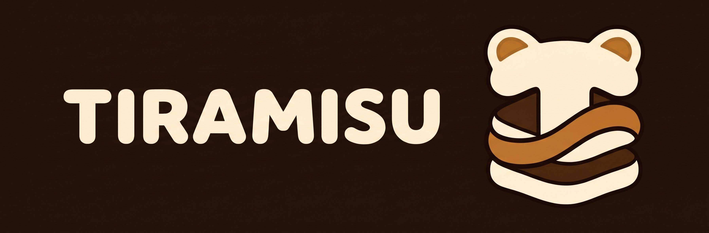
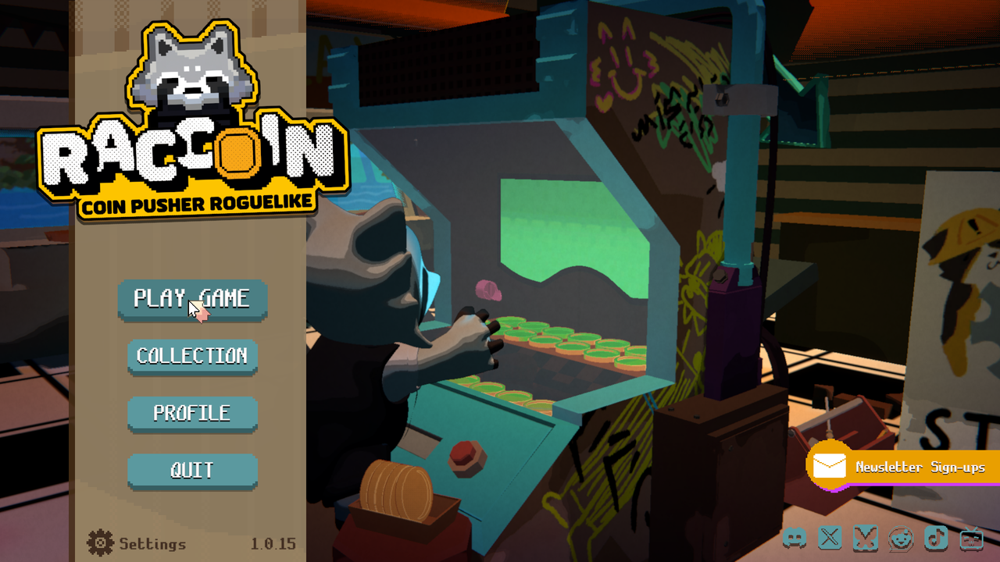
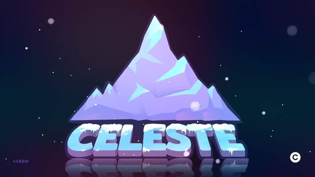
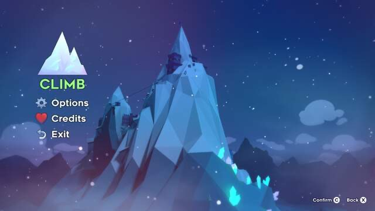
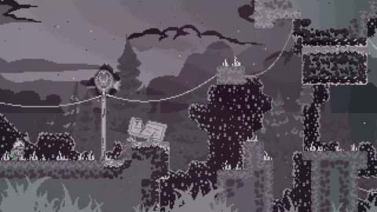
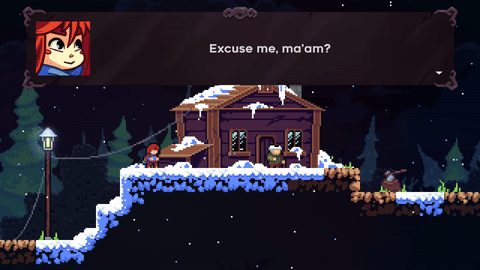
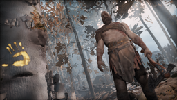

<div align="center">



### Run PC games on Xbox Series X|S — natively.

**A Windows PE64 application runtime for Xbox Dev Mode.**
Wine's job, targeting UWP instead of POSIX.


[How it works](#-how-it-works) · [Console proof](#console-proof-2026-11-19) · [What boots](#-what-boots-today) · [Build](#-build-linux-all-cross) · [Status](#-status) · [Evidence](docs/03-evidence.md) · [Gap map](GAP-MAP.md)

**[⬇ Download the release](https://github.com/xanstomper/tiramisu/releases)** · **[🎮 Compatibility](#-what-boots-today)**

</div>

---

## What is this?

One signed UWP app that loads Windows `.exe`s **in-process** on Xbox
Series X|S Dev Mode. No CPU emulation for 64-bit games: the console is x64,
so guests run at **native speed** on the same core, the same ABI, the same
process — Tiramisu is the operating system around them.

```text
Tiramisu UWP host (CoreWindow + D3D11 flip + XInput, 5 GB as a Game package)
  └── trt — Tiramisu runtime
        ├── PE64 loader      map → sections → relocate → bind imports → TLS → delay imports
        ├── Win64 EH         .pdata personality, RtlUnwindEx, funclets, VEH
        ├── module table     every import routed: SYSTEM | BUILTIN | STUB
        ├── bridges          25+ Win32 families implemented on UWP
        │   ├── graphics     D3D11/DXGI (real device passthrough), D3D9/8/DDraw→D3D11,
        │   │                D3DX9/10/11, OpenGL→D3D11 (gl4es-derived), Vulkan 1.0–1.3 ICD
        │   │                (SPIR-V→HLSL→D3D11), GDI32, GDI+ (launcher UI)
        │   ├── audio        XAudio2 / DirectSound / WASAPI / OpenAL / winmm / FMOD
        │   │                → one real XAudio2 2.8 mixer (48 kHz stereo master voice)
        │   ├── system       kernel32 core+mem+thread, ntdll, advapi32 registry, ole32/oleaut,
        │   │                shell32/shlwapi, comctl32, crypt32, bcrypt, wininet, psapi,
        │   │                iphlpapi, imm32, dbghelp, setupapi/HID, winrt (Gamepad…)
        │   └── steam        QR auth (your own account) — no DRM bypass, ever
        ├── VFS              C:\ → LocalState\drive_c, D:\ → mounted .iso, Z:\ → package
        ├── budget governor  one 5 GB ledger for VirtualAlloc commit + heap + mapped views
        └── async I/O        overlapped reads → GQCS packets, mmap fast path (TRT_IO_MMAP_MIN)
```

## Console proof (2026-11-19)

RACCOIN, God of War and Celeste are running on an Xbox Series S in Dev Mode, loaded by
the signed Tiramisu MSIX. No CPU emulation, no streaming, no PC in the loop.

### RACCOIN — playable

RACCOIN is a Unity 6 IL2CPP build using D3D11. It reaches its own menu and
plays a run.

<table>
<tr>
<td width="50%"><br/>
<sub><b>Main menu.</b> Play Game, Collection, Profile, Quit. Version 1.0.15.</sub></td>
<td width="50%"><br/>
<sub><b>Run in progress.</b> Round 8/15, Current 392, Combo 35, a full coin bed.</sub></td>
</tr>
</table>

[](docs/proof/raccoin-gameplay.mp4)

Over the clip the HUD goes from Current 116 to 392, Top 1 from 22 to 61, Hand
In from 44 to 19, and Score Rate from 1.0 to 2.8, while the coin bed keeps
moving. The last frame matches the gameplay still, so both come from the same
run. The clip is 36 frames captured at 5 fps; that is the capture rate, not
the game's frame rate.

### Celeste — playable

**Celeste v1.4.0.0** (XNA/Mono, FNA stack) is playable on the Series S — the
first **managed .NET game** to run on Tiramisu. The 32-bit engine embeds a
UWP build of Mono 6.8.0.105 and drives FNA3D against the host's real D3D11
device + CoreWindow swapchain.

<table>
<tr>
<td width="50%"><br/>
<sub><b>Title screen.</b> Mountain logo, icy letters, snow particles. v1.4.0.0.</sub></td>
<td width="50%"><br/>
<sub><b>Main menu.</b> Climb, Options, Credits, Exit — fully navigable.</sub></td>
</tr>
</table>

[](docs/proof/celeste-greyscale-test.mp4)

**The greyscale bug.** The first gameplay test rendered in full greyscale:
the PNG decoder computed the wrong bytes-per-pixel for RGB images (2 instead
of 3), scrambling the color-grading lookup tables Celeste loads as PNGs — so
the (correct) scene graded to grey and Madeline's red hair showed green.
Console tests plus a GPU LUT readback pinned it, and a one-line patch fixed
it ([`e776951`](https://github.com/xanstomper/Tiramisu/commit/e7769512dadd0d71f0dede486e283dfb49046f0f)).

[](docs/proof/celeste-gameplay.mp4)

**Chapter 1: Forsaken City, in full color.** Madeline runs, jumps and climbs
through the opening screen — navy sky, green pines, blue snow, red hair. The
clip looks low-framerate because it is assembled from Device Portal
screenshots captured at ~2 fps; the game itself runs smoothly at 50–60 fps
on the console. Audio is silent — FMOD FSB/Vorbis sample decode is disabled
on console because it heap-corrupted on the Series S.

### God of War — boots and renders the forest

God of War is the PC build, running on the same D3D11 path. These are four
separate boots, ordered by how much of the scene each one rendered.

<table>
<tr>
<td width="50%"><br/>
<sub><b>1.</b> Scene appears. Heavy black occluders, missing foliage, broken materials.</sub></td>
<td width="50%"><br/>
<sub><b>2.</b> Character materials resolve: skin, tattoo, cloth, axe, handprint, bark.</sub></td>
</tr>
<tr>
<td width="50%"><br/>
<sub><b>3.</b> Geometry and depth return: denser foliage, layered trees, readable sky.</sub></td>
<td width="50%"><br/>
<sub><b>4.</b> Full composite: god rays, layered foliage, character and axe together.</sub></td>
</tr>
</table>

The captures are 256×144 preview stills. They show the scene and the render
path, not final resolution or frame pacing.

### What the evidence does and doesn't cover

Proven: RACCOIN's own menu renders; a RACCOIN run executes with live game
state; God of War boots to the forest and renders a composite frame at preview
resolution.

Not shown: God of War's menu or gameplay, audio for either title, frame times,
long-session stability, save/profile round-trips, or 720p+ output for God of
War. Two titles are not universal compatibility.

### Console fixes behind these frames

- **Native TLS preserved during guest execution.** Without it, RACCOIN's D3D11
  resource creation stalled and the splash alternated with black frames.
- **One stable render target plus a host flip copy.** The guest renders into a
  single target; the host copies it into the Xbox flip chain. This removed the
  alternating-black-frame failure.
- **GC thread adoption.** Unity's collector suspends guest threads. The first
  run died with `Fatal error in GC: SuspendThread loop failed` because it was
  handed a pseudo-handle; the fix adopts the real thread and uses a
  park/verify/resume loop.
- **Native GameInput path.** Keyboard and mouse reach the foreground guest
  through the console's GameInput instead of a desktop-only assumption.
- **Manifest and memory-ledger changes for God of War.** The larger title
  needed host manifest work and a bigger slice of the 5 GB Game package.

## ⚙️ How it works

### 1. Load — the PE64 loader

A real Windows PE64 is mapped from the game directory (or a mounted `.iso`):
DOS → NT headers → section mapping with per-section protections → DIR64 /
HIGHLOW relocations → import binding → TLS callbacks → **delay imports bound
eagerly** (resolvable symbols get real addresses; unresolvable ones get a
fail-visible thunk so the game boots and the log names the gap) → the whole
image is **W^X sealed** (code pages RX, no RWX ever — a two-phase JIT
fallback arms RW and flips RX on `FlushInstructionCache` for engines that
JIT, like Unity mono).

### 2. Bind — the module table

Every import routes to one of three classes:

- `SYSTEM` — the console's real DLL (proven-present families only; the host
  binds via `LoadLibraryW`+`GetProcAddress`),
- `BUILTIN` — Tiramisu implements it with Wine-observable semantics
  (kernel32 core/memory/thread, user32 window layer, graphics, audio, COM,
  registry, ~25 families, ~2,000 functions),
- `STUB` — exported, logs when called, returns 0: **fail-visible, never a
  silent lie**. Every stub hit in a log is roadmap work.

Guest-shipped DLLs (UnityPlayer, GameAssembly, SDL3, libstdc++, FMOD…)
load recursively as real PEs and their `DllMain(PROCESS_ATTACH)` actually
executes.

### 3. Run — native execution

The guest's entry point is called on a host thread at native speed. Threads
with Win32 semantics, sync primitives, TLS, real file enumeration, async
file I/O with completion ports, and the memory budget governor (one ledger
for commit + heap + mapped views; over-budget refusals are **named**, which
is what keeps the console's 5 GB Game-package limit survivable) are provided
by `trt`.

### 4. Draw — the console passthrough

The guest's `D3D11CreateDevice` gets the **host's real console device**;
`CreateSwapChainForHwnd` (and every other swapchain-creation variant) gets a
proxy over the **host's real CoreWindow swapchain** — `Present`,
`GetBuffer`, `ResizeBuffers` forward to real console DXGI. D3D9/D3D8/DDraw
games are translated onto the same backend. Vulkan games run through the
built-in Vulkan 1.0–1.3 ICD: SPIR-V → HLSL → D3D11 on the console GPU.
OpenGL games ride the gl4es-derived GL→D3D11 path. Shader execution is
**the console's real D3D11** — no shader translation needed for D3D11 guests.

### 5. Survive — Win64 exception handling

Full Win64 C++ EH — the part that took the longest: `.pdata` personality
search, two-pass `RtlUnwindEx`, MSVC funclet rethrow splicing, VEH
first-chance, and the host→guest boundary pad for exceptions that escape the
guest. Measured on real Unity IL2CPP games whose engines raise managed
exceptions through native frames.

### 6. Prove — boot ladders are measured, not promised

Every claim in the status table traces to a test or a captured log — see
[docs/03-evidence.md](docs/03-evidence.md). The offline harness can inject
mock GPU hooks so a real game's **render loop executes end-to-end** with
every vtbl call counted:

```text
RACCOIN.exe (real Unity IL2CPP Steam game) — offline boot ladder:
  CRT-STARTUP → WINMAIN → UNITYMAIN2 (IAT-probed) → WINDOW →
  D3D11 DEVICE ACQUIRED → PUMP ENTERED → PUMP QUIT
  mock-render gate: 2,730,468 device-context calls, ~268,000 DrawIndexed
  in the 10 s window, clean ExitProcess(0).                     7/7 markers
```

## 🎮 What boots today

| Game (corpus, gitignored) | Type | Result |
|---|---|---|
| **RACCOIN** | Unity 6 IL2CPP, Steam, D3D11 | **Playable on console.** Menu, live run, coin physics, HUD progression; 7.2 s capture. |
| **God of War** (PC) | AAA in-house engine, x64, D3D11 | **Boots and renders on console.** The opening forest, across four boots; menu and gameplay next. |
| **Celeste** (v1.4.0.0) | XNA / Mono + FNA (managed .NET) | **Playable on console.** Title, menu, Chapter 1 gameplay; first managed game to run. Audio silent. |
| **Ultra Pool** | Godot 4.3 + GodotSteam (Vulkan) | **Full lifecycle** — scene load → pump → Godot's own quit chain, exit(0) |
| **Go Next (demo)** | Unity IL2CPP | boots, reaches `UNITYMAIN2` |
| OrTMM | PyInstaller / commercial | full CRT→WinMain→window→pump lifecycle |
| BotW-Native (launcher + recomp exe) | BOTW Wii U static recomp | whole MinGW/SDL3/OpenSSL/glslang binary set loads + `DllMain` clean |
| GoWLauncher | Win32 launcher | loads 1/0 — launcher only, not the game above |

**Engine classes covered:** Unity IL2CPP + **mono**, **XNA/Mono via FNA (managed .NET)**,
AAA in-house D3D11, Godot 4.x (Vulkan),
PyInstaller/Python, static-recomp ports, Win32 launchers, GDI+ UI apps,
FMOD-audio games.

**Not yet:** 32-bit x86 (PE32) games — needs the M7 x86 engine; D3D12 AAA
titles offline (console D3D12 path exists, hardware-verification pending);
Wwise/Miles-audio games (named next bridges). See
[GAP-MAP.md](GAP-MAP.md).

## 🖥️ Dashboard (TV) & phone/web dashboard

The launcher on the TV has three screens — cycle with **RB/LB** (or `Tab`):

- **Shelf** — game list (U/D pick, L/R choose the exe when a game has several),
  A launches, Y opens the Steam QR link, R3/F1 toggles gamepad-as-mouse.
  The LAN URL + QR for game transfer is always on screen.
- **Settings** — editable rows: default input mode (`auto`/`controller`/`kbm`/
  `pad2kbm`), pad-as-mouse + wheel speed, pad vibration on/off, the **Windows
  version reported to games** (major.minor.build, Win11 personality toggle),
  write-watch GC on/off (GetWriteWatch kill-switch), Steam link on/off,
  QR overlay on/off, log tail size. Every change persists to
  `LocalState\settings.ini` and applies to guests immediately.
- **Live log** — the same ring the web dashboard shows, streamed from memory.

The phone/PC web dashboard (open the LAN URL shown on the TV, or scan the QR)
adds a Connect card, the game manager (**upload folder/zip → extract → pick
exe**, per-game args/appid/input, launch/stop/delete), the live log, and the
**same settings editor** (`GET/POST /api/settings`) — all offline-gated in
`tests/test_webxfer.cpp`.

## 🚀 Quick start (console)

```sh
# 1. install the runtime (from a PC on the same LAN)
DP_HOST=<console-ip> DP_PASS=<portal-pass> \
  tools/deploy.sh install out/Tiramisu.msix out/dev.cer

# 2. open the dashboard shown on the TV (or scan the QR) and upload
#    your game as a folder or .zip — pick its .exe — press launch

# 3. watch the TV
tools/deploy.sh screenshot tv.png
```

To push a game straight from the PC instead of the phone page — and to record
proof for the title matrix:

```sh
python3 tools/game-stage.py "~/Games/<Title>" --out staging/<Title> --exe <rel.exe>
python3 tools/console.py upload --game staging/<Title> --console <console-ip>
python3 tools/console.py proof  --game staging/<Title> --console <console-ip>
```

`game-stage.py` refuses a 32-bit exe (Tiramisu runs PE32+ only) instead of
uploading gigabytes that cannot start. `--set key=value` stages a per-game
`tiramisu.profile.ini` (e.g. `--set fsb_decode=1` to try FSB5 audio decode on
one title); it is the only settings channel a packaged app can read. Proven titles live in
[docs/title-matrix.md](docs/title-matrix.md), which is generated from
`docs/proof/titles.json` + `proof.json` — `python3 tools/title-matrix.py
--check` fails if a row cites an artifact that is not on disk.

No console on the network? The whole deploy path can be rehearsed offline:
`python3 -m unittest discover -s tests/py_tools` runs `console.py` against a
fake Device Portal over real TLS (CSRF cookie/header, basic auth, multipart
install, batched file upload, launch, screenshot, log fetch, `proof.json`).

Prereqs on the console: Device Portal enabled and **"Treat UWP apps as games
by default" ON** (5 GB limit, not 1 GB). Games you **own**; DRM-free builds
or your own Steam account auth. **No DRM bypass, ever.**

## 🔨 Build (Linux, all cross)

```sh
tools/build-test.sh    # full offline gate: 49 suites, real PE guests executed
tools/build-host.sh    # the UWP host cross-build (clang-cl + lld-link)
tools/pack.sh          # makemsix pack + sign + verify → out/Tiramisu.msix
```

Needs: LLVM 19 (`clang-cl`, `lld-link`), xwin splat at
`~/.cache/uwp-crossbuild/xwin`, `makemsix`, `osslsigncode`, and the
uwp-crossbuild wrapper (defaults to `~/gow-uwp/ref/uwp-crossbuild`; override
with `UWP_CROSSBUILD`). Python + Pillow for the branding assets
(`package/branding/` is the source of every packaged logo; regenerate with
`python3 tools/gen-assets.py`).

## 📚 Docs

- `docs/known-issues.md` — measured/honest limitations.
- `docs/troubleshooting.md` — common failures and fixes.
- `docs/crash-reporting-plan.md` — planned opt-in crash reporting (not built).
- `docs/title-matrix.md` — evidence-backed title matrix (`tools/title-matrix.py --check`).
- `tools/auto-compat.py` — scan any PE64 game and report API coverage vs. Tiramisu bridges. Supports `--scaffold DIR` to generate stub bridge skeletons.
- `docs/known-issues.md` — honest list of open engine walls and what's been stubbed vs. implemented.
- `CHANGELOG.md` — version + change history.
- `GAP-MAP.md` — walls and what's open.

## 📊 Status

> Every layer is "done" only when a test or a console run proves it.
> Failures are **visible and named** — never silent.

| Layer | State |
|---|---|
| Offline loader (real PE guest executed on Linux) | **PASS** — mapping, DIR64/HIGHLOW reloc, import binding, delay imports, W^X seal, entry execution |
| Win64 C++ EH (SEH) | **PASS** — pass-1 personality search, RtlUnwindEx pass-2, funclet rethrow splice, geometric purge, VEH, boundary swallow pad |
| Real-game corpus | **PASS** — 29 PEs load; RACCOIN playable and God of War rendering on console; UltraPool/GoNext/OrTMM boot |
| D3D11/DXGI guest | **PASS on console** — real device + CoreWindow swapchain used by both titles |
| D3D9/D3D8/DDraw → D3D11 bridges | **BUILT** — SDK-exact vtables |
| Vulkan 1.0–1.3 ICD (SPIR-V→HLSL→D3D11) | **BUILT** — Godot 4.3 boots through it |
| Audio (XAudio2 / DirectSound / WASAPI / OpenAL / winmm / **FMOD**) | **BUILT** — one real XAudio2 2.8 sink; FMOD WAV/OGG decode for real |
| Memory + budget governor | **BUILT** — 5 GB ledger, W^X two-phase JIT (mono enabler), write-watch |
| Guest-shipped DLLs, delay imports, api-set contracts | **BUILT** — recursive bind, DllMain run, UCRT C-library real answers |
| Registry, COM/OLEAUT, shell, COMCTL, GDI, **GDI+** | **BUILT** |
| Steam | **BUILT (auth only)** — QR login; `BIsSubscribedApp` answers 0 (no DRM bypass) |
| ISO / disc images | **BUILT** — `.iso` → read-only `D:` drive, lazy per-file extraction |
| Input (keyboard/mouse/gamepad, DInput8, XInput, Raw Input) | **PASS (RACCOIN)** — CoreWindow events → guest getters + pump; pad-as-mouse |
| Console run | **PASS (2026-11-21)** — RACCOIN playable; God of War renders the forest; **Celeste playable (title, menu, Chapter 1)** |
| 32-bit x86 (PE32) | **not supported** — needs an x86 engine; see GAP-MAP W5 |

<details>
<summary><b>Full layer-by-layer table (60+ rows)</b> — click to expand</summary>

| Layer | State |
|---|---|
| UWP host (CoreWindow/D3D11/XInput/LocalState log) | **BUILDS** — signed `Tiramisu.msix` produced and verified |
| Phone transfer (QR on TV → upload zip → launch) | **BUILT** — ws2_32 HTTP server, miniz zip extraction, launch handoff; console verdict pending |
| DirectInput 8 | **BUILT** — SDK-exact vtables, mouse deltas + 256-key map from the real input ring |
| Real file enumeration (FindFirstFile family) | **BUILT** — dual-platform REAL (Linux readdir / console native passthrough), SDK-exact 592-byte `WIN32_FIND_DATAW` |
| Temp-path boot chain (PyInstaller) | **BUILT** — `GetTempPathW/2W`, VFS-relative resolution |
| /GS cookie killer | **FIXED** — `GetFileAttributesExW` layout bug found by hardware watchpoint; regression test in `test_engine.cpp` STAGE 9 |
| shlwapi / shell32 / shfolder | **BUILT** — Path* helpers, SHGetFolderPath W/A, KnownFolders, real IMalloc |
| COM boot + OLEAUT | **BUILT** — CoInitialize (STA/MTA nesting), CLSID personalities with GUID-named failures, BSTR, SafeArrays, Variants |
| COMCTL32 + GDI32 + GDIPLUS | **BUILT** — InitCommonControlsEx + ordinal `#380`, subclass family, GDI object table, GDI+ flat API (launcher UI, recorded draws) |
| UCRT C-library surface | **BUILT** — 115 ms_abi host-libc wrappers (heap/str/wcs/math/qsort/_initterm) — MinGW guests survive DllMain |
| Boot determinism — UNCERTAIN-7 all BUILTIN | **BUILT** — wininet/psapi/iphlpapi/imm32/crypt32/dbghelp honest-runtime bridges; MiniDumpWriteDump writes a REAL text crash report through the VFS |
| D3DX9 / D3DX10/11 | **BUILT** — exact math, texture load (BMP/TGA/PNG/DDS), ID3DXSprite quad batching |
| Image parsers + stb_image | **BUILT** — hand PNG/DDS decoders + vendored stb_image fallback |
| GLSL/SPIR-V → HLSL | **VENDORED** — mojoshader, d3d8to9, gl4es, stb_vorbis (licenses kept) |
| msacm32/msvfw32/winspool | **BUILT** — honest no-codec / no-printer answers |
| Pre-boot compat scanner | **BUILT** — shelf reads each PE and flags steam-auth/d3d9/d3dx9/dsound/ddraw/d3d11 before launch |
| Launcher setup UI | **BUILT** — first-run live checklist; A opens the shelf |
| Async file I/O + mmap | **BUILT** — overlapped reads → GQCS packets, `TRT_IO_MMAP_MIN` mmap fast path, suite 42 |
| Budget governor | **BUILT** — one 5 GB ledger; over-budget refusals named; suite 41 |

</details>

## 🗺️ Roadmap

- **M0 console PoC — done (2026-11-19).** Signed MSIX deploys; RACCOIN
  reaches its menu, starts a run and plays; God of War boots and renders the
  forest; Celeste boots and renders its title screen. Evidence:
  [Console proof](#console-proof-2026-11-19).
- **M1b — Celeste gameplay — done (2026-11-21).** Menu navigation, level
  entry and Chapter 1 gameplay verified on console. Console audio still to
  restore (FSB/Vorbis decode currently disabled due to a heap-corruption
  fault in the Series S AppContainer).
- **M1 front end + sustained play — in progress.** God of War's normal
  front-end/menu path; RACCOIN soak test and frame-time capture; audio and
  save validation.
- **Any-game breadth** — x86-32 PE32 loader + translator ladder; streaming
  maps; IOCP/dstorage; D3D12 (see [GAP-MAP.md](GAP-MAP.md))
- **Audio breadth** — MP3/ADPCM/FSB decoders for FMOD; Wwise; Miles
- **Steam depot download (M6)** — play *your* Steam library from your own
  account

## 🧱 Rules of the road

- Games you **own**; DRM-free builds or your own Steam account auth.
- **No DRM bypass, ever.** No Xbox security bypass. No game files or
  credentials in the repo.
- MIT for our code; vendored third-party keeps its licenses
  (see `THIRD-PARTY.md` and vendored dirs).

## 📚 Documentation

| Doc | Contents |
|---|---|
| [docs/03-evidence.md](docs/03-evidence.md) | what is proven vs assumed — every fix traces to a measurement |
| [docs/04-support-roadmap.md](docs/04-support-roadmap.md) | the walls between "a few titles boot" and "any PC game runs", ranked by library share |
| [docs/support-matrix.md](docs/support-matrix.md) | auto-generated, measured per-title `real / recorded / named-silent` import coverage |
| [docs/proof/](docs/proof/) | console captures: RACCOIN menu, run and clip; four God of War boots; Celeste title, menu, greyscale test and gameplay |
| [GAP-MAP.md](GAP-MAP.md) | live gap table, W-lanes, dependency order, triggers |
| [docs/](docs/) | architecture notes, stage logs, console playbook |

---

<div align="center">

**🍰 Tiramisu** — because the console already has the hardware; it just needed
the cake.

*Built for Xbox Dev Mode. Homebrew the honest way.*

⭐ Star this repo if you like native-speed PC games on Series X|S.

</div>
